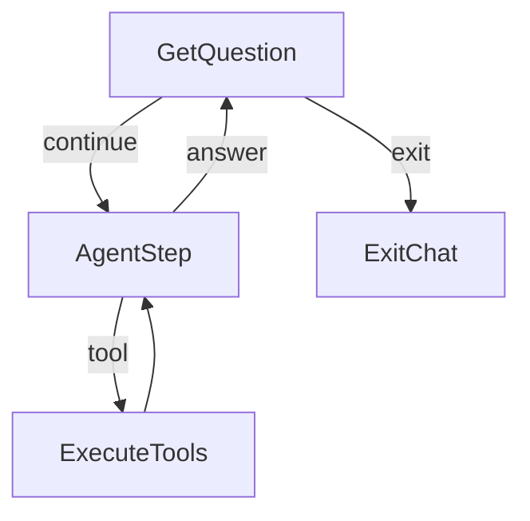

# deepseek-flow

[](https://github.com/poladb-afk/deepseek-flow/actions/workflows/calidad.yml)

Un agente de terminal construido sobre [PocketFlow](https://github.com/The-Pocket/PocketFlow)
(el framework de 100 líneas) con **DeepSeek V4.1 Flash** como LLM y una
arquitectura de **CORE + módulos**: un chat mínimo con capacidades de solo
lectura, y cada capacidad nueva que se agrega es un archivo que se deja en
`modules/` (y se quita borrándolo).



## Filosofía

Heredada de PocketFlow y de [bmo](../bmo) (el harness que inspiró los módulos):

- **Los datos exactos los cuenta el código; el LLM solo interpreta.**
- **Un módulo = un archivo** con `TOOLS` (esquemas) e `IMPL` (implementaciones).
  El registro los descubre al arrancar: agregar = dejar el archivo, quitar = borrarlo.
- **Todo bucle tiene presupuesto** (ley L8 de bmo): rondas de herramientas,
  rondas del juez, rondas de debate, pasos del supervisor.
- **Las reglas del repo son gates, no prosa**: cada regla no negociable de
  `AGENTS.md` nombra el gate determinista que la hace cumplir (inventario de
  tests, deriva de docs, ratchet de métricas). Lo que todavía no se puede
  verificar queda declarado como regla blanda, no disfrazado.
- **Forma humana, no ruido de IA**: el código se escribe para que lo lea una
  persona — mínimo que funciona, sin defensas ni abstracciones que el pedido
  no exige, sin banners ni docstrings de relleno, sin reimplementar helpers.
  Lo que se puede contar se cuenta con un gate (`ratchet.py`,
  `tests/test_estilo_humano.py`); el resto es review honesto.
- **Los errores son información**: un tool que falla devuelve `ERROR: ...`
  como texto y el modelo se autocorrige; la escritura de archivos exige
  aprobación humana (HITL) — `s/n` en la terminal, o desde el navegador
  con `HITL_WEB=1` — y EOF/Ctrl+C/timeout cuentan como rechazo.
- **HITL graduado**: con `HITL_AUTO=1` (default) el riesgo del comando
  decide la fricción. Solo-lectura verificado (`pytest`, `grep`, `ls`,
  `git status`…) corre **auto** (con el comando igual a la vista); lo no
  reconocido pregunta como siempre; `git push` y `rm -rf` piden **dos**
  confirmaciones. `HITL_AUTO=0` vuelve al `s/n` para todo. Además, un
  **hook** post-tool corre `py_compile` tras escribir un `.py` y le
  devuelve `⚠ SINTAXIS` al modelo para que se autocorrija; y un **hook
  pre-tool** veta sin `s/n` los comandos de daño irreversible
  (`rm -rf /`, fork bomb) por denylist dura.
- **El chat responde en vivo**: las respuestas se imprimen token a token
  mientras se generan (`CHAT_STREAM=1`, default) y un Ctrl+C durante la
  generación corta la respuesta conservando lo parcial (`CHAT_STREAM_INTERRUPT`,
  default 1); `0` en cualquiera vuelve al comportamiento clásico.

## Quickstart

```bash
pip install -r requirements.txt
cp .env.example .env        # ajusta lo que quieras
export DEEPSEEK_API_KEY=sk-...
python3 main.py             # el chat
```

Sin `.env`, el agente opera sobre el directorio actual (portable por defecto).

### En una PC nueva, el harness entero (Laya incluida)

Los checkpoints de Laya no van en el repo (643 MB cada uno, demasiado para
git) sino en una [release](https://github.com/poladb-afk/deepseek-flow/releases/tag/laya-v2);
un comando los baja, verifica y deja listos:

```bash
./descargar_modelos.sh
```

Sin ese paso el harness funciona igual — el router del chat y el Choose del
supervisor degradan al lado DeepSeek; solo se pierden los ifs locales (ms,
costo 0).

## Capacidades (29 tools, al día de hoy)

| Origen | Herramientas |
|---|---|
| CORE (lectura) | `list_files`, `read_file`, `search_files` |
| escritura (HITL) | `write_file` — diff + `s/n`, default seguro |
| coding (HITL) | `run_command` — shell con HITL graduado por riesgo (`HITL_AUTO=1`), timeout y salida truncada |
| coding (HITL) | `edit_file` — reemplazo exacto y único (diff quirúrgico) |
| HITL web | con `HITL_WEB=1` las aprobaciones se responden desde el navegador |
| juez | `answer_verified` — borrador → juez (verifica citas contra archivos) → refinamiento; `rondas` opcional |
| juez (lote) | `juez_lote` — N preguntas verificadas EN PARALELO (`AsyncParallelBatchFlow`) + medición de speedup |
| informe | `run_informe` — map-reduce paralelo de trazas `.jsonl` |
| auditoria | `run_auditoria` — BatchFlow multi-carpeta + síntesis comparativa |
| research | `deep_research` — web + loop de cobertura |
| debate | `debate` — proponente vs crítico por colas + juez |
| supervisor | `run_supervisor` — v2: un paso = UNA llamada con tool-calling nativo (herramienta + args juntos); vetos, caché y presupuesto como guardas de código |
| db | `sql` / `db_schema` — SELECT de solo lectura sobre SQLite |
| effective_n | `run_effective_n` — deduplicación exacta por contenido (Effective N; 1 o varias carpetas, `BatchFlow`) |
| evals | `evals` — el harness juzgándose a sí mismo: bench del router, linter de trazas, costo por sesión (tool del chat: informe a disco SIN pisar el baseline) |
| rag | `rag_search` / `rag_index` — búsqueda semántica local (fastembed) |
| memoria | `memory_search` / `memory_save` — biblioteca consultable entre sesiones |
| vision/PDF | `ver_imagen` / `ver_pdf` — mira imágenes (data-URL base64) y lee PDFs (rasterizados con `pdftoppm`, página → imagen); tipo por contenido, límites chequeados antes de llamar |
| websearch | `search_web` — ddgs sin API key |
| mcp | `mcp_tools` / `mcp_call` — consume servidores MCP externos |
| a2a | `agentes_remotos` / `a2a_tarea` — consume agentes remotos (protocolo agent2agent); setting `A2A_AGENTS` |
| humano | `request_human_input` — el modelo le pregunta al usuario cuando le falta información (factor 7) |

## Memoria entre sesiones

La memoria es una **biblioteca consultable**, no contexto auto-inyectado.
Cada chat arranca con la memoria vacía (nada entra al system prompt); el
agente la consulta por tools solo cuando el pedido lo justifica:

- `memory_search(query)` — `query` opcional (sin ella, lista la biblioteca); busca texto (insensible a mayúsculas) en los
  markdown de `memoria/` y devuelve archivo+línea, más el listado de la
  biblioteca. Código puro, sin LLM.
- `memory_save(titulo, contenido)` — guarda `memoria/nota_FECHA_slug.md`
  con el título como primera línea. Sin HITL (es la libreta del agente)
  pero con contención dura: solo escribe dentro de `memoria/`, el nombre
  sale de un slug del título (sin rutas ni `..`). La biblioteca no sigue
  enlaces simbólicos (ni al leer ni al escribir).
- Al **compactar** una sesión larga, la zona fría (lo que se descarta) se
  respalda **literalmente** —sin LLM— en `memoria/nota_FECHA_compactacion-*.md`
  y el marcador `[compacción]` nombra ese archivo: el detalle sigue siendo
  recuperable con `memory_search` en vez de perderse.

Al salir del chat, si `MEMORIA=1` (default) y hubo al menos 2 preguntas,
**una** llamada a `call_llm` resume la conversación y la guarda como
`memoria/sesion_FECHA.md` (bookkeeping, sin HITL; si la llamada falla se
sale igual). Al **arrancar**, el chat muestra el catálogo de la biblioteca
(nombre y conteo de notas) SIN inyectar su contenido — el arranque vacío
es regla. `memoria/` no se versiona (está en `.gitignore`).

## Privacidad y datos locales

Todo lo que el harness escribe queda **en el repo o en `salidas/`**. Qué
guarda cada sink, con qué default y cómo apagarlo:

| Dato | Archivo | Default | Apagador |
|---|---|---|---|
| Pregunta del usuario, **texto en claro** (4000 chars) | `salidas/preguntas.jsonl` | **encendido** | `PREGUNTAS_LOG=0` |
| Decisión del router (sin texto) | `salidas/routing.jsonl` | `LAYA_LOG_DECISIONES=1` | `LAYA_LOG_DECISIONES=0` |
| Texto de la pregunta dentro del evento de routing | — | apagado | `LAYA_LOG_PREGUNTA=1` (200 chars) |
| Juicio de riesgo de comandos (exp/44) | `salidas/riesgo.jsonl` | activo si hay `LAYA_MODEL_RIESGO` | sin modelo, es no-op |
| Transcripción COMPLETA del `shared` por checkpoint | `salidas/threads/<id>.jsonl` | `THREAD_PERSIST=1` | `THREAD_PERSIST=0` |
| Traza de nodos (nodo/acción/segundos, sin contenido) | `.runs/*.jsonl` | `TRACE=1` | `TRACE=0` |
| Biblioteca de notas y resúmenes de sesión | `memoria/*.md` | `MEMORIA=1` | `MEMORIA=0` |
| Respaldo de la zona fría al compactar | `memoria/nota_*_compactacion-*.md` | con la compacción | `COMPACTION_CHARS=0` |

`PREGUNTAS_LOG` es el único sink con **texto del usuario encendido por
default**: existe para calibrar el router con tráfico real (exp/33/43) y el
archivo está en `.gitignore`. Si tratás datos sensibles, arrancá con
`PREGUNTAS_LOG=0` y `THREAD_PERSIST=0`. No hay retención automática: los
archivos crecen hasta que los borres.

## CLI completo

```bash
python3 main.py                          # chat
python3 main.py juez "pregunta" [--rondas N] # respuesta con verificación de citas
python3 main.py juez_lote preguntas.txt  # N preguntas EN PARALELO (+ speedup medido)
python3 main.py informe [carpeta]        # map-reduce de trazas .jsonl
python3 main.py auditoria c1 c2          # multi-carpeta comparativa
python3 main.py research "tema"          # investigación web con loop
python3 main.py debate "tema" [--rondas] # debate multi-agente
python3 main.py supervisor "tarea"       # orquestación de piezas
python3 main.py effective_n [carpeta ...] # deduplicación exacta (1 o varias carpetas)
python3 main.py evals                   # evals: bench del router + linter de trazas + costos
python3 main.py heartbeat [--ahora]    # piezas programadas (cron nocturno)
python3 main.py visor [trace.jsonl]    # HTML del trace (default: el último)
python3 main.py index [carpeta]          # indexar para RAG
python3 carga_trazas.py                  # (script aparte) jsonl → SQLite
python3 sonda_router.py [ckpt]        # (script aparte) router con compuerta
python3 main.py mcp-server               # exponer capacidades vía MCP
python3 main.py grafo [flujo]            # exportar los grafos a mermaid
python3 main.py bench_juez               # bench de answer_verified (grading por código)
python3 main.py replay [trace.jsonl]     # re-valida trazas .runs contra los grafos actuales
python3 main.py ratchet                  # métricas estructurales: helpers duplicados + tests (ratchet)
python3 main.py resume <id>              # rehidrata un thread del chat (salidas/threads/)
```

Cada corrida deja un trace por nodo en `.runs/*.jsonl`.

### Alcance y presupuesto del chat

`MAX_TOOL_ROUNDS` (default 8) corta las rondas de tools por pregunta; al
agotarse, el agente cierra igual con un aviso de cierre forzado (medido en
vivo: antes podía quedar en silencio). Con LLM real: el alcance **medio** (un
directorio, ~20 archivos) entra en 8 rondas; el alcance **amplio** (repo
completo) agota 8 y 16 rondas leyendo, así que conviene subir
`MAX_TOOL_ROUNDS` (>=16) o acotar el pedido. El agente declara el alcance que
cubrió y lo que quedó afuera.

## Estructura

```
deepseek-flow/
├── main.py            # entry point + subcomandos
├── nodes.py / flow.py # el CORE: bucle del agente
├── AGENTS.md          # el contrato para agentes: reglas + gate de cada una
├── modules/           # capacidades del chat (TOOLS + IMPL por archivo)
├── informe|juez|juez_lote|auditoria|research|supervisor|debate|rag|mcp_server|effective_n|evals|heartbeat|visor|replay|resume|bench_juez|carga_trazas.py
│                      # piezas standalone (CLI) — los módulos las exponen
├── ratchet.py         # las métricas no empeoran (baseline en ratchets/)
├── ratchets/          # baseline versionado del ratchet
├── utils/             # call_llm, fs_tools, policy, laya, laya_routing, conformal,
│                      # compaccion, contexto, prefetch, riesgo, thread_store,
│                      # hitl_web, mcp_client, tracing, viz, websearch…
├── memoria/           # biblioteca entre sesiones (ignorada)
├── salidas/           # informes generados por las corridas (ignorada)
├── tests/             # smoke tests (pytest)
├── docs/estado.md     # el estado VIVO de cada hallazgo (una fila por id)
├── docs/design.md     # el diseño vigente: grafos, contratos, leyes/límites
└── docs/bitacora.md   # cómo se llegó acá: cada exp/N con su medición
```

## Documentación

- **[AGENTS.md](AGENTS.md)** — el contrato para agentes: qué leer primero,
  reglas no negociables con su gate, reglas blandas y bypasses prohibidos.
- **[docs/estado.md](docs/estado.md)** — el tablero vivo: una fila por hallazgo
  (A/H/R) con su estado, la evidencia y el test que lo cubre. Empezá por acá.
- **[docs/design.md](docs/design.md)** — lo que es verdad hoy: grafos,
  contratos de `shared`, leyes/límites y el diseño de cada pieza.
- **[docs/bitacora.md](docs/bitacora.md)** — el registro medido: cada `exp/N`,
  las jornadas y los fixes de auditoría (de dónde salió cada decisión).
- **[docs/roadmap.md](docs/roadmap.md)** — próximos pasos priorizados.
- **[docs/informes/](docs/informes/)** — informes de diseño vigentes; las
  auditorías y contrastes cerrados quedan en
  [`docs/informes/archivo/2026-10/`](docs/informes/archivo/2026-10/).

## Testing

```bash
./calidad.sh                     # el gate completo: ruff + complejidad + ratchet + pytest
python3 -m pytest tests/ -q      # solo la suite (un archivo por tema, ver tests/)
python3 -m pytest -m "not laya and not bmo and not red and not datos"   # subconjunto determinista
```

Cada test que se saltea por un recurso lo declara con un marker: el marker
dice **qué** falta (`laya`, `bmo`, `red`, `datos`), el `skip` dice por qué.

Cuatro candados de la propia suite: `tests/test_inventario.py` compara lo
que pytest recolecta contra `tests/inventario_tests.txt` (un test que
desaparece se nombra, en vez de dejar de correr en silencio) y falla si un
archivo de test pasa de 800 líneas; `ratchet.py` compara helpers privados
duplicados, tests definidos, `except` amplios, código muerto privado y cuerpos
duplicados contra `ratchets/baseline.json`
(la métrica puede mejorar o quedar igual, nunca empeorar sin decisión del
operador); y `tests/test_estilo_humano.py` veta la firma de IA en el código
(banners decorativos, docstrings de relleno, wrappers vacíos), exige motivo
visible en cada `except` amplio y que el system prompt pida el mínimo código.

## Créditos

- [PocketFlow](https://github.com/The-Pocket/PocketFlow) — el framework (100 líneas, cero dependencias).
- [bmo](https://github.com/) — la arquitectura de módulos, las leyes de
  bucles y Laya vienen de ahí.
- [DeepSeek](https://www.deepseek.com/) — V4.1 Flash (`deepseek-flash`).
- [git-agent-ratchet](https://github.com/monk-eee/git-agent-ratchet) — el
  mecanismo del ratchet (baseline shrink-only + guardia anti-bypass) que
  inspiró `ratchet.py`.
- [ruleward](https://github.com/kernullist/ruleward) — el linter de reglas
  (bloat y deriva) que inspiró `tests/test_deriva_reglas.py`.
- [AI-Agent-Coding-Rules](https://github.com/Emmanuel-Bamidele/AI-Agent-Coding-Rules)
  — la estructura de reglas/checklists que inspiró `AGENTS.md`.
- [Ponytail](https://github.com/DietrichGebert/ponytail) — la pirámide
  YAGNI ("el mejor código es el que no escribiste") y la regla "lazy, not
  negligent" que ordenan la forma del código en `AGENTS.md`.
- [code-humanizer](https://github.com/LeonardNJU/code-humanizer) — el
  catálogo de tells de código de IA (banners, docstrings de relleno,
  wrappers vacíos, `except` amplio) que `tests/test_estilo_humano.py` y el
  ratchet hacen deterministas.
- [slop-scan](https://github.com/modem-dev/slop-scan) — el método de
  benchmark contra código humano previo a 2025 que fundamenta la medición de
  `docs/informes/codigo_ia_vs_humano_2026-10-19.md`.
- [mattpocock/skills](https://github.com/mattpocock/skills) — "skills for
  real engineers, not vibe coding": el diseño de módulos y el lenguaje
  compartido como raíz del ruido, base del enfoque de este repo (ver
  `docs/informes/codigo_ia_vs_humano_2026-10-19.md`).
