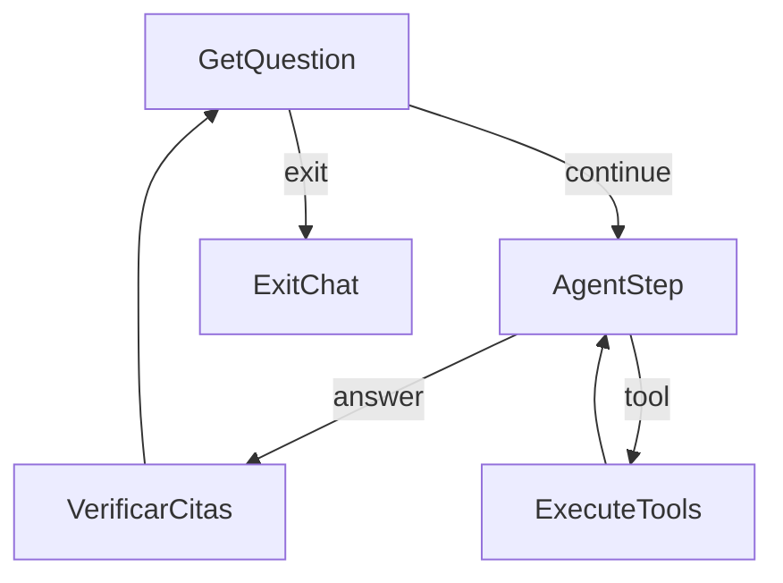
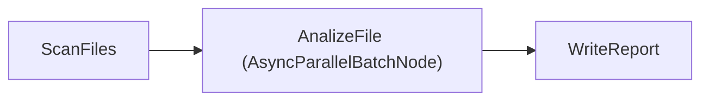
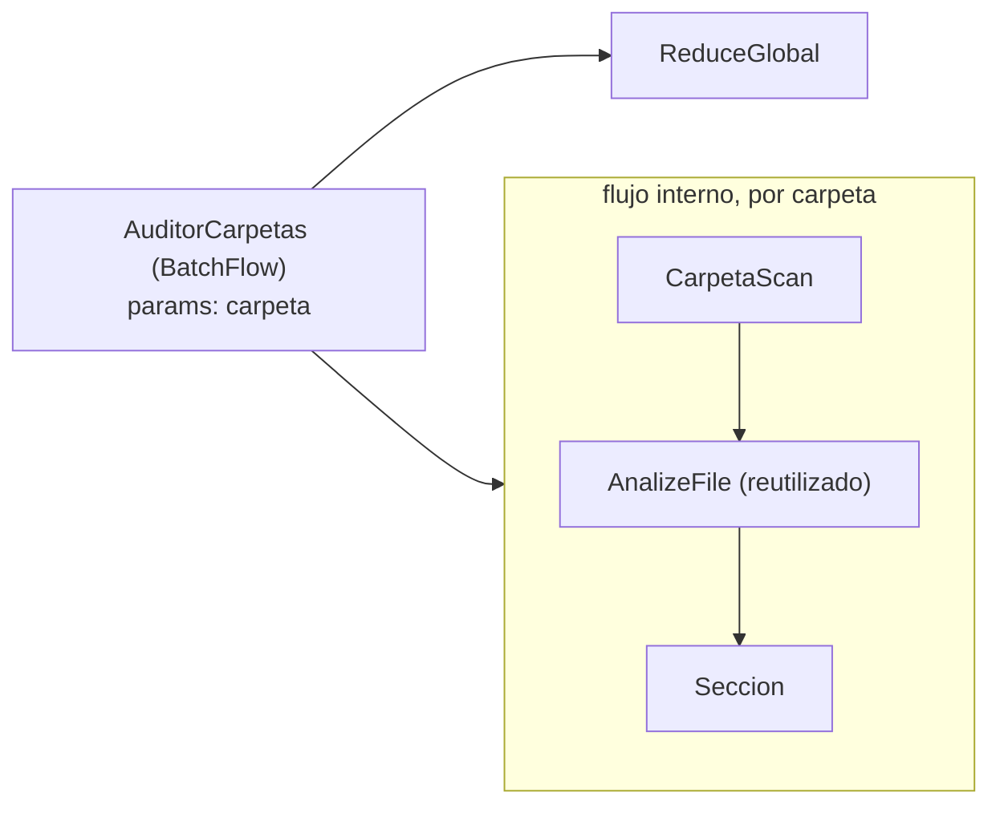
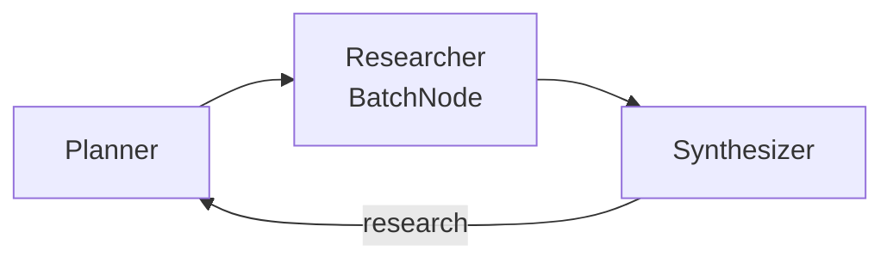
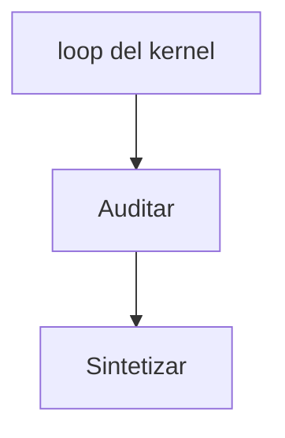
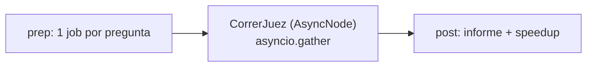

# deepseek-flow — diseño

Agente de terminal con herramientas de lectura de archivos, conectado a
**DeepSeek V4.1 Flash** (`deepseek-flash`, `https://api.deepseek.com`),
armado con PocketFlow.

## Objetivo

Un chat que **no cierra** y que, para responder sobre los archivos del
usuario, los explora por sí mismo: decide cuándo listar y cuándo leer
(patrones Chat + Agent del cookbook). Las credenciales viven **fuera** del
proyecto: `DEEPSEEK_API_KEY` en el entorno o `LLM_API_KEY` en el `.env` de bmo.

## Flujo



Es el patrón Agent (decidir → actuar → volver a decidir) implementado con
**tool calling nativo** de DeepSeek en vez de YAML: `AgentStep` manda el
historial + definiciones de tools; si el modelo responde con `tool_calls`,
la acción `tool` ejecuta y el bucle vuelve a `AgentStep`; si responde con
texto, la acción `answer` imprime y vuelve a esperar la siguiente pregunta.

## Sanitizado de respuestas descarriladas y thinking selectivo

Tres episodios medidos en producción (2026-10-05, todos en el camino
directo): un system prompt ajeno pegado al saludo, un `<small>` que
partía una palabra, una palabra espuria ("¿EnAnswered?"). Dos capas de
respuesta:

1. **Causa raíz (la más probable)**: `call_llm_agent` desactivaba el
   thinking SIEMPRE, aunque la llamada fuera sin tools — y la restricción
   A1 (con `tools` en el request, la API exige devolver el
   `reasoning_content` completo; corregido el 2026-10-13, la versión
   original decía "API rechaza tools+thinking") solo aplica con tools.
   Sin tools ahora va con thinking normal; verificado en vivo: respuestas
   limpias en ambos caminos.
2. **Defensa en profundidad**: `sanitizar()` en `AgentStep.post` corta
   en markers de rol ajenos (`<system>`, `[INST]`…; si no queda nada,
   el reintento del nodo re-pregunta) y quita tags HTML espurios que
   parten palabras (`S<small>oy` → `Soy`), sin tocar markdown legítimo.

## Streaming de respuestas (CHAT_STREAM)

Roadmap ítem 6. `call_llm_agent_stream(messages, tools=None)` en
`utils/call_llm.py` comparte el MISMO `_kwargs_agente` que la versión
clásica (contrato de modo thinking pegajoso y filtro de `reasoning_content`
sin deriva) pero con `stream=True`: imprime en vivo cada delta de CONTENT
(`print(..., end="", flush=True)`, sin saltos extra) y descarta los deltas
de reasoning_content. Al terminar devuelve un objeto con la forma que usa
el chat: `.content` ensamblado y `.tool_calls` reconstruidos desde los
fragmentos (llegan partidos por `index`; `id` y `function.name` solo en el
primer fragmento de cada llamada; `function.arguments` se acumula por
concatenación). Si el stream se corta a mitad, devuelve lo acumulado sin
explotar.

`AgentStep.exec` (y por herencia `DirectAnswer`, sin tocar su clase) usa la
versión stream cuando `CHAT_STREAM == "1"` (default) y la clásica con `0`.
El resto del flujo no cambia (historiar, recuperación DSML, sanitizar,
ExecuteTools). Como con streaming el contenido crudo ya se imprimió en
vivo, si `sanitizar` corta, tras el aviso existente se imprime también la
versión limpia (`DeepSeek (limpio): …`). Y como ya salió en vivo, `post()`
NO reimprime la respuesta completa: con stream solo cierra la línea (los
deltas van sin salto); con la clásica mantiene el `print("\nDeepSeek: …")`.

**Interrupción del usuario (CHAT_STREAM_INTERRUPT, default 1)**: un Ctrl+C
MIENTRAS se genera corta el stream y se devuelve lo acumulado — se imprime
`[interrumpido]` y el chat sigue (el parcial queda historado y mostrado, el
flujo vuelve al prompt). Con `0`, el `KeyboardInterrupt` se propaga y `main`
lo trata como salida, como siempre. El Ctrl+C fuera del stream no se toca.

**Corte por error, sin causa muda (2026-10-05)**: el `except Exception`
del stream sigue devolviendo lo acumulado (una caída de red no rompe el
chat), pero ya no **enmascara** la causa cuando no hay nada que devolver:
con CERO contenido acumulado imprime `[stream] se cortó sin contenido
(<Tipo>: <causa>)` — un 401/429/red con respuesta vacía deja de ser un
misterio (fragilidad medida en la caza de bugs). Con contenido parcial el
corte benigno no agrega ruido.

## Recuperación del canal de tools (DSML como texto)

Medido en producción (2026-10-05): a veces DeepSeek emite las tool calls
como TEXTO crudo con su markup interno (DSML, `<｜DSML｜｜ invoke …>`) en
vez del canal estructurado — el chat las imprimía como respuesta y se
quedaba esperando, sin ejecutar nada. `AgentStep.post` ahora lo detecta:
sin `tool_calls` pero con la marca DSML en el contenido → `dsml_a_tool_calls`
parsea de vuelta los invokes (misma forma que la API) y los INYECTA en el
mensaje, con el markup limpiado para que el historial quede canónico. El
camino `tool` existente sigue intacto. Test con el transcript real.

## Comunicación (shared)

| Clave | Contenido |
|---|---|
| `messages` | Historial completo: system (fijo) + user + assistant (con `tool_calls` cuando pidió herramientas) + tool (resultados). Es lo único que DeepSeek recibe en cada vuelta |
| `turno` | **La caja de la pregunta en curso** (H2 PR 4a, `nodes.nuevo_turno()`): `rondas` (L8), `sin_progreso`/`huella` (exp/13), `huellas_vistas`/`racha_sin_novedad`/`corte_novedad` (exp/52-B), `aviso_cierre`, `skill` (exp/55), `router_pendiente` (exp/43) y `uso_inicio` (exp/90). `GetQuestion` la REEMPLAZA entera: no hay `pop` que olvidar. Es JSON y viaja en el checkpoint |
| `_objetivo` / `tokens_por_pregunta` | De la SESIÓN, no de la pregunta: la tarea vigente (un "seguí" no la pisa) y el costo cerrado de cada pregunta |
| `compacciones` / `_compaccion_huella` | Compactaciones aplicadas al historial y huella del historial ya compactado (evita re-compactar la misma ronda) |
| `_respaldo_huella` / `_respaldo_ruta` | Huella de la última zona fría respaldada en `memoria/` y ruta de ese respaldo: si la siguiente compacción descarta la MISMA zona fría no se reescribe (exp/70; el marcador A17 sigue nombrando la ruta vigente) |
| `operacion` / `max_tool_rounds` | Perfil de presupuesto declarado por el invocador y override explícito del techo; los lee `presupuesto()` (hoy el chat no los siembra) |

## Nodos

| Nodo | Tipo | prep | exec | post |
|---|---|---|---|---|
| GetQuestion | Node | — | `input()` (ignora vacías; EOF → exit) | `salir/exit/quit` → `exit`; si no, resetea el presupuesto por pregunta (ley L8) y agrega el mensaje user → `continue`; `/aprobaciones` imprime el historial HITL y NO entra al historial |
| AgentStep | Node (max_retries=3, wait=5) | historial + tools (sin tools si ya gastó el límite) | `call_llm_agent` (o `call_llm_agent_stream` con `CHAT_STREAM=1`) | agrega el mensaje del asistente; con `tool_calls` → `tool`; si no, imprime → `answer` (con streaming el `print` solo cierra la línea: la respuesta ya salió en vivo) |
| ExecuteTools | Node | último `tool_calls` | ejecuta cada llamada (`run_tool_call`) | agrega mensajes tool, suma `tool_rounds` → `default` |
| VerificarCitas | Node (max_retries=2, wait=2) | la última respuesta (si `CITAS_VERIFICAR=1` y no trae `tool_calls`) | verifica `ruta:línea` contra el disco; si alguna falla, UNA corrección sin tools (`exec_fallback`: si la corrección revienta, queda la respuesta) | reemplaza el contenido corregido → `default` (antes vivía en `AgentStep.post`, sin retry: auditoría F6) |
| ExitChat | Node | — | — | imprime despedida |

## Utilities

- `call_llm(messages)` → texto (smoke test).
- `call_llm_agent(messages, tools=None)` → mensaje del asistente, con
  `extra_body={"thinking": {"type": "disabled"}}` cuando hay tráfico de
  tools. La razón DOCUMENTADA (docs oficiales, verificados 2026-10-13):
  con `tools` en el request la API exige devolver el `reasoning_content`
  completo en todas las requests subsecuentes; este cliente lo descarta,
  así que thinking va desactivado en todo tráfico agéntico (la anotación
  A1 original —"rechaza tools+thinking juntos"— describía el síntoma, no
  la regla; ver la sección del modo pegajoso).
- `call_llm_agent_stream(messages, tools=None)` → igual contrato, con
  `stream=True`; imprime el CONTENT en vivo y devuelve el mensaje
  ensamblado (content + tool_calls). La versión clásica sigue disponible
  con `CHAT_STREAM=0`.
- `fs_tools.py` — el cuerpo del agente:
  - `list_files(path?, depth)`: listing con tamaños; sin path lista los
    directorios permitidos; salta `.venv*`, `.git`, `__pycache__`,
    `node_modules`; truncado a 300 entradas.
  - `read_file(path, offset, limit)`: páginas de hasta 500 líneas,
    recortada a `READ_MAX_CHARS` (corta el medio).
  - `search_files(query?, glob?, path?)`: busca por nombre (glob) y/o por
    texto en el contenido (insensible a mayúsculas); devuelve rutas y
    números de línea; topes de 50 archivos / 200 líneas, 5 líneas por
    archivo; omite binarios y archivos de más de 4 MB en búsquedas de
    contenido.
  - `run_tool_call(tc)`: dispatch + mensaje `role=tool`. Los errores de uso
    ("ERROR: ...") se devuelven como texto para que el modelo corrija; los
    fallos transitorios del API los maneja el retry del Node.

## Leyes / límites

| Límite | Qué | Dónde |
|---|---|---|
| Contención | Ninguna ruta sale de `AGENT_ALLOWED_DIRS` (resueltas con `Path.resolve`) | `fs_tools._resolve` |
| Rondas | `presupuesto(shared)` por pregunta (override > perfil de `operacion` > `MAX_TOOL_ROUNDS`); al llegar, `AgentStep` retira las tools y el modelo debe responder. Se reinicia con cada pregunta nueva del usuario (el comando `/aprobaciones` incluido, que no agrega mensaje) | `nodes.presupuesto`, `AgentStep.prep` |
| No-progreso | Repeticiones idénticas de la ronda de tools (`fingerprint` de nombre+argumentos) a `UMBRAL_SIN_PROGRESO`: se retiran las tools sin esperar el techo, con el evento `corte_no_progreso` en la traza | `nodes.fingerprint`, `ExecuteTools.post`, `AgentStep.prep` |
| Contexto | `READ_MAX_CHARS` por lectura, listados truncados | `fs_tools` |
| Reglas duras del router | recencia (`regla_temporal`, exp/46) e imperativos de capacidad (`regla_imperativo_capacidad`, exp/54) mandan a herramientas ANTES de Laya; en shadow no cortan | `utils/laya_routing.py` |
| Convergencia | corte OPCIONAL por falta de novedad (tool+argumentos; `CORTE_NOVEDAD=k`). **A/B exp/52-B negativo**: redundancia real ≈0 → default 0=off; la huella queda en la traza | `nodes.corte_por_novedad_activo` |

## Segundo flujo: informe map-reduce

```
python3 main.py informe [carpeta] [--glob '*.jsonl'] [--salida informe.md]
```

Default: `.` (el CWD — portable; `INFORME_CARPETA` en .env fija otra,
p. ej. `~/Documentos/00_IA/bmo/data` en esta máquina). También corre
directo con `python3 informe.py`.



Patrón Map-Reduce del cookbook con **mapa paralelo**: `AnalizeFile` es un
`AsyncParallelBatchNode` (las llamadas a DeepSeek se solapan con
`asyncio.gather`) dentro de un `AsyncFlow`; `ScanFiles` y `WriteReport`
quedan síncronos — `AsyncFlow` ejecuta los `Node` normales tal cual y solo
espera a los `AsyncNode`. La utilidad es `call_llm_async` (`AsyncOpenAI`):
dentro de `gather` tiene que haber I/O esperado de verdad, o nada se
solapa. `asyncio.gather` conserva el orden: el informe es determinista.
Hechos exactos en código, interpretación en LLM (principio de bmo).

Medido: una llamada ≈ 5,5 s; el pipeline completo (12 mapas en paralelo +
1 síntesis secuencial) ≈ 12 s.

| shared | Contenido |
|---|---|
| `folder`, `glob`, `salida` | configuración sembrada por main |
| `files` | rutas encontradas (ScanFiles) |
| `analisis` | `[{file, total, errores, modulos, ejemplos, resumen}]` (AnalizeFile) |
| `informe` | ruta del markdown final (WriteReport) |

Topes: `MAX_FILES=30`, 2 tareas de ejemplo por archivo, reintentos 3/wait 5
en mapa y reduce (el BatchNode reintenta **por archivo**, no por lote).

## Skills declarativas (Mesa 7, exp/55)

`skills/*.yaml` empaqueta un modo de trabajo: `condicion` (regex determinística
sobre la pregunta), `instrucciones` (prompt que se inyecta con prefijo
`[skill]`) y `tools` (subset que el loop anuncia mientras el skill está
activo). `utils/skills.py` los carga (YAML roto se saltea) y expone funciones
puras (`skill_para`, `mensaje`, `filtrar_tools`). En **enforce**, el
`LayaRouter` evalúa el disparo en `post`: si matchea, fuerza herramientas,
inyecta el contexto y anuncia el skill; `AgentStep` recorta la lista de tools
al subset. En shadow no cambia conducta; `SKILLS=0` apaga. El recorte de tools
es GUÍA (no sandbox): el action space sigue completo y la seguridad sigue en
HITL/policy. Dos skills iniciales: `revision` y `tdd`.

## Módulos: el CORE y sus capacidades

El chat es el **CORE**: capacidades base de solo lectura (`fs_tools`) más
las herramientas que aporten los módulos. Un módulo es un archivo en
`modules/` que exporta `TOOLS` (esquemas OpenAI) e `IMPL`
(nombre → implementación). `modules.discover()` los junta al arrancar y
`nodes.py` arma el action space: `core + módulos`.

- Agregar una capacidad = dejar un archivo en `modules/`.
- Quitarla = borrarlo (el descubrimiento es al iniciar el proceso).
- Una pieza puede existir standalone y exponerse como módulo:
  `modules/informe.py` es solo el adaptador de `informe.py`, que sigue
  funcionando sola (`main.py informe`).

Es la arquitectura de bmo ("one node, one module, one capability") en su
forma mínima: el action space del agente **es** el registro de módulos.

| Módulo | Herramienta | Qué hace |
|---|---|---|
| `informe` | `run_informe(carpeta?, glob?, salida?)` | lanza el pipeline map-reduce y devuelve la ruta del markdown; el progreso se imprime en vivo |
| `escritura` | `write_file(path, content)` | escribe dentro de los directorios permitidos **con aprobación humana (HITL)**: vista previa (diff si existe) y `s/n` en la terminal — o desde el navegador con `HITL_WEB=1` (`utils/hitl_web.py`); EOF/Ctrl+C/timeout cuentan como rechazo (default seguro); el rechazo vuelve al modelo como texto para que corrija; contenido idéntico → no-op |
| `juez` | `answer_verified(pregunta, rondas?)` | responde con control de calidad: borrador → juez → refinamiento; el juez verifica citas ruta:línea contra el contenido real; `rondas` fija el tope de evaluación (default 2) |
| `juez` (lote) | `juez_lote(preguntas, salida?)` | verifica N preguntas EN PARALELO (AsyncParallelBatchFlow) reutilizando el flujo del juez; informe con una sección por pregunta + speedup medido |
| `auditoria` | `run_auditoria(carpetas, glob?, salida?)` | audita varias carpetas a la vez (una sección por carpeta + síntesis comparativa) |
| `rag` | `rag_search(consulta, k?)` / `rag_index(carpeta?, glob?)` | búsqueda semántica sobre el índice local (embeddings fastembed) y (re)indexación |
| `debate` | `debate(tema, rondas?)` | debate multi-agente (proponente vs crítico por colas) con juez final |
| `mcp` | `mcp_tools()` / `mcp_call(servidor, herramienta, argumentos)` | habla el Model Context Protocol: consume herramientas de servidores MCP externos configurados en `MCP_SERVERS` — el action space deja de ser cerrado |
| `websearch` | `search_web(consulta, k?)` | búsqueda web con ddgs (DuckDuckGo, sin API key); devuelve título, URL y resumen para citar |
| `research` | `deep_research(tema, salida?)` | loop de cobertura: planner → researcher (web) → synthesizer; detecta huecos y re-planifica (MAX_ROUNDS=2) |
| `supervisor` | `run_supervisor(tarea, salida?)` | bucle reactivo: Laya (Choose local, umbral 0.9) o DeepSeek eligen la herramienta de cada paso; síntesis final |
| `db` | `sql(consulta)` / `db_schema()` | SELECT de solo lectura sobre la base SQLite de trazas (una sentencia, LIMIT forzado, sin DDL) |
| `effective_n` | `run_effective_n(carpetas?, glob?, salida?)` | deduplicación exacta por contenido de trazas .jsonl: Effective N, archivos duplicados enteros, solape por pares, contradicciones de etiqueta; 1 o varias carpetas (BatchFlow, informe conjunto) |

### HITL web — la aprobación desde el navegador
`utils/hitl_web.py` · [utils/hitl_web.py](../utils/hitl_web.py)

Con `HITL_WEB=1`, las aprobaciones de `write_file`, `edit_file` y
`run_command` dejan de pedir `s/n` por stdin: `aprobar(titulo, cuerpo)`
levanta (perezoso, una sola vez) un servidor HTTP en `127.0.0.1:8765`
(`HITL_WEB_PORT`) que sirve una página simple con el título, el cuerpo
(el diff o el comando) dentro de `<pre>` y dos forms con botones
**Aprobar / Rechazar** que hacen POST a `/decision`. Solo stdlib
(`http.server` + `threading`) — sin dependencias nuevas. Un solo pedido
pendiente a la vez (`threading.Event`), timeout `HITL_WEB_TIMEOUT`
(300s): timeout o error ⇒ `False`, el mismo default seguro que el CLI.
El chat, el agente y el CORE no cambian una línea: `_approve` de cada
módulo solo elige la fuente de la respuesta (navegador o terminal).

**Webhook autenticado (Mesa 7, exp/57)** sobre el mismo server loopback:
`POST /webhook` recibe `{"tipo": "...", "detalle": ...}` de otros procesos y
lo persiste en `WEBHOOK_LOG` (JSONL, gitignored) + memoria; `GET /eventos`
devuelve los últimos de la sesión. Seguridad primero: token en header
`X-Webhook-Token` comparado en **tiempo constante** contra `WEBHOOK_TOKEN`
(vacío ⇒ 503, nunca abierto por default), Host/Origin de loopback (mismo
corte anti DNS-rebinding que el HITL), `WEBHOOK_MAX_BYTES` (cuerpo) y
`WEBHOOK_MAX_POR_MINUTO` (rate limit). El token y el `detalle` NUNCA se
loguean (solo `tipo` e `id`). Servicio: `python3 main.py webhook` levanta
HITL+webhook y bloquea hasta Ctrl+C.

### Chat web MVP (Mesa 8, exp/59) — SSE con stdlib
`utils/webchat.py` · [utils/webchat.py](../utils/webchat.py)

Con `WEBCHAT=1` sobre el server del HITL web: `GET /chat` sirve una página
mínima (sin CDN ni build), `POST /chat/sesion` crea una sesión,
`POST /chat/mensaje` manda la pregunta, `GET /chat/stream?sesion&token` es SSE
y `POST /chat/cerrar` la termina. **Aislamiento real**: cada sesión corre el
chat COMPLETO en un subproceso (`python3 -u main.py`), así hereda grafo,
streaming, tools, skills y HITL sin tocar el CORE; nada de estado compartido
entre pestañas. Seguridad al nivel del webhook: solo loopback (Host/Origin),
token aleatorio por sesión comparado en tiempo constante, tope
`WEBCHAT_MAX_SESIONES` (3) y TTL `WEBCHAT_TTL` (900 s). El texto del navegador
NO se persiste: el hijo corre con `PREGUNTAS_LOG=0`, `NO_COLOR=1` y `TRACE=0`.
Las aprobaciones HITL salen por la página HITL existente (otra pestaña) porque
el server HITL vive en el subproceso y publica su URL en el stream.
Límites del MVP (declarados): sin reconexión SSE, sin markdown renderizado,
HITL no embebido, una sesión por pestaña.

### Servidor MCP (dirección inversa)

`python3 main.py mcp-server` expone las capacidades del chat a OTROS
agentes por stdio ([mcp_server.py](../mcp_server.py)). Allowlist en
`MCP_EXPOSE` (default: solo lectura + rag + juez + juicio local; excluye
write_file por el HITL de terminal y los pipelines largos). En stdout viaja
el protocolo: todo aviso del servidor va a stderr.

`juicio_laya` es **mcp-laya** (exp/65): el juicio tipado y calibrado de Laya
como tool para cualquier agente MCP, sin que el cliente cargue un modelo.
Entran `estado`, `instrucciones` y `opciones` (`{etiqueta: criterio}`, mínimo
2); sale texto JSON `{juicio, confianza, probabilidades, modelo}`. Sin
checkpoint devuelve `ERROR:` como texto (nunca rompe al cliente). NO es una
tool del chat: no suma al action space del modelo; el producto es servir a
terceros.

> El detalle medido de cada experimento (exp/2 a exp/50, las jornadas y los
> fixes de auditoría) vive en [bitacora.md](bitacora.md): acá queda solo lo que
> es verdad hoy.

## Piezas: juez, auditoría, RAG y debate

Cada pieza es standalone (subcomando CLI) Y módulo del chat.

### Juez — evaluator-optimizer + structured output
`main.py juez "pregunta"` · [juez.py](../juez.py)


`Draft` recibe en prep el contenido real de los archivos mencionados en
la pregunta (los hechos los reúne el código). `Judge` extrae las citas
`ruta:línea` del borrador, lee las líneas reales, y evalúa en YAML
(`verdict: ok/retry`) — `extraer_yaml` + `_veredicto_valido`: un veredicto
que no valida **no lanza** — el Judge reintenta citando el crudo inválido como
feedback (fase B2 de exp/21, en [bitacora.md](bitacora.md)). Tope de rondas `JUEZ_ROUNDS` (default 2, ley L8),
configurable por corrida con `--rondas N` o `shared["max_rounds"]`; la tool
`answer_verified(pregunta, rondas?)` lo expone.

### Juez de trabajo (fable) — el adversarial de trabajo terminado
`main.py fable_judge trabajo/ --pristine ref/ --reporte reporte.md` · [fable_judge.py](../fable_judge.py)


F1 del port de [fable-method](https://github.com/Sahir619/fable-method)
(@9924067, MIT; método en `skills/fable-judge/SKILL.md`, diseño del port en
el [mapeo](informes/fable_method_mapeo_2026-10-21.md) §4.2): juzga TRABAJO
TERMINADO, no preguntas — "un reporte es un conjunto de claims, no
evidencia". Los dos nodos LLM (claims y juicio) usan structured output con
loop de reparación (crudo inválido citado verbatim + fallback semántico,
fase B2 del juez de respuestas); los otros tres son deterministas:

- **EstablecerCambio**: diff `trabajo/` vs `pristine/` (difflib, sin
  basura de tooling); sin pristine, `git diff` best-effort; sin referencia
  los cambios quedan UNVERIFIABLE (nunca asumidos).
- **ReEjecutar**: re-ejecuta las verificaciones que el reporte clama, con
  allowlist propia (un `python`/`pytest` simple, sin metacaracteres de
  shell) y despacho SIEMPRE por `run_command` de `modules/coding` (policy
  + HITL graduado, nunca shell libre). El ejecutor es inyectable
  (`ejecutar=`) para los tests. Un claim no re-ejecutable es UNVERIFIABLE.
- **Verdictar**: la **compuerta** de hechos del código (mismo patrón que el
  Judge de respuestas): una verificación clamada que falla al re-ejecutarse
  fuerza REFUTED aunque el modelo diga VERIFIED, y un verified con fraudes
  se refuta solo. El formato es el de fable: veredicto en la primera línea
  + tabla de claims (claim → qué se observó) + fraudes con evidencia +
  acción recomendada. Contrato de veredicto: `verified |
  verified_with_caveats | refuted`.

Presupuestos (L8): `MAX_CLAIMS=12`, `MAX_RERUNS=6`, diff al prompt truncado
(`MAX_DIFF`), reparación de YAML a 2 intentos. La tool del chat
`verificar_trabajo(trabajo, pristine?, reporte)` (módulo `fable`) la expone;
el reporte llega como ruta o texto literal. Medición: exp/81 sobre el
fixture s7 (5 fraudes plantados) en [bitacora.md](bitacora.md).

**Dominios (F3, exp/82)**: con `sector` (ej. `marketing`), el trabajo
no-código se juzga con el **adapter del dominio** — la fraud table, el
evidence set y el orden de autoridad del sector reemplazan los de código
(los archivos del trabajo viajan al prompt como FUENTES, acotadas, porque la
evidencia está en los archivos y no en un diff; el vocabulario del `tipo`
de fraude del contrato es el de las filas de la tabla del adapter). Los 8
adapters + TEMPLATE de fable-method viven como datos versionados con
atribución MIT en `banco/material/fable/dominios/` y los carga
[utils/fable_dominios.py](../utils/fable_dominios.py) (puro; un .md sin las
secciones vinculantes se saltea con aviso — mismo grep que el CI del repo
original). Medición: exp/82 sobre el fixture s8 (6 fraudes de copy contra
`brand.md`/`product-facts.md` que el juez debe descubrir solo).

**Archivos nuevos con contenido (exp/83)**: en modo código, el contenido de
los archivos NUEVOS del diff viaja al prompt después del diff
(`contenido_nuevos`) — sin él, el juez no ve las aserciones de un test nuevo
y refuta trabajo honesto (gap medido por el control honesto del operador).
Presupuesto por archivo = el remanente del tope, con contabilidad exacta de
lo que viaja (header + cuerpo + separador + marca de corte). La allowlist de
re-ejecución admite `ruff check` (solo lectura; `ruff format` escribe y no
entra). Fix implementado por el propio chat del harness con `PROMPT_FABLE=1`
y auditado por `verificar_trabajo` — el meta-juicio cazó dos bugs reales del
tope que los tests de ambos lados dejaban pasar (exp/83).


### Auditoría — BatchFlow + flujo anidado (Flow como Node)
`main.py auditoria c1 c2 [--glob] [--salida]` · [auditoria.py](../auditoria.py)



El `AsyncBatchFlow` re-corre el flujo interno una vez por carpeta con
`params["carpeta"]` (el identificador viaja en params, los datos en
shared), y el BatchFlow mismo se enchufa como nodo en el Flow exterior
antes del reduce. Iteraciones secuenciales a propósito: comparten shared.

### RAG — offline index + online retrieve
`main.py index [carpeta] [--glob]` · [rag.py](../rag.py) · [utils/embeddings.py](../utils/embeddings.py)

Offline: `ChunkDocs → EmbedChunks → SaveIndex` (BatchNodes; chunks de
1200 chars con overlap, embeddings fastembed locales — paraphrase-
multilingual-MiniLM, sin API key — guardados en `rag_index/`). Online:
`buscar(consulta)` encasta por coseno y devuelve top-k con ruta y score.
Sin embedder disponible degrada a BM25 léxico (mismo flujo, otro scorer).
El modo viaja por `flow.set_params` — params para config de tarea.

### Debate — multi-agente con colas`main.py debate "tema" [--rondas]` · [debate.py](../debate.py)

Proponente y Crítico son dos `AsyncFlow` independientes que se
auto-apuntan (`agente - "continue" >> agente`) y se comunican SOLO por
`asyncio.Queue` (patrón Taboo del doc de multi-agent). Sentinel `FIN`
para terminar limpio; `JuezDebate` dictamina en YAML reutilizando
`extraer_yaml`. Las call_llm síncronas dentro de async son correctas:
el debate es ping-pong, solo uno piensa a la vez.

### Research — loop de cobertura (la inversión del juez)
`main.py research "tema"` · [research.py](../research.py)



El synthesizer juzga la COBERTURA (no la respuesta): con huecos, vuelve
al planner con feedback; presupuesto MAX_ROUNDS=2. Web por ddgs,
structured output en todo (extraer_yaml + assert + retry).

### Supervisor — el loop del kernel con las leyes del ejecutor (v3, H2 PR 2)
`main.py supervisor "tarea"` · [supervisor.py](../supervisor.py) · [sonda_supervisor.py](../sonda_supervisor.py)



**v3 (H2 PR 2, 2026-10-26)**: el supervisor no tiene loop propio. El loop es
el del kernel (`utils/kernel.loop`, un Flow usado como Node) y cada tool del
catálogo es una `Tool` envuelta por `con_leyes`: las guardas puras
(`guarda_vetada`, `guarda_repetida`) deciden ANTES de despachar y los
contadores se actualizan DESPUÉS, con el estado de ley en el shared (no en
globals) y un lock porque las lecturas corren en paralelo. `Auditar` arma la
sección "Pasos" y la telemetría de rondas secas desde el registro de
llamadas. El saldo (`Ledger(MAX_PASOS)`) es UNO para el árbol: con
`EXPLORAR=1` la exploración gasta del mismo saldo, y el kernel no ofrece
`explorar` si no queda saldo para ella y su loop (≥ 2). Probado contra v2 con
el mismo LLM guionado en 5 casos (cierre, lecturas, tope, veto por fallos,
caché): mismas llamadas, mismos pasos, mismos vetos.

**Historia (v1, antes de exp/bench 2026-10-13):**

ElegirSiguiente (Laya con la task **supervisor_dispatch**: 18 opciones =
17 tools + finish; `uncertain` o sin laya → DeepSeek con el catálogo) →
EjecutarPaso (args por mini-llamada DeepSeek + ejecución + el hecho
`N herramienta(args) -> resultado` que verá la elección siguiente) →
repetir hasta finish o MAX_PASOS=5 (L8) → Sintetizar. Antes era una
tanda: un plan de una vez y los pasos dependientes quedaban fuera; ahora
el paso N+1 decide con el resultado del N — el Choose de bmo. El estado
`{tarea, hechos}` y `PREGUNTA_DESPACHO` replican la task byte a byte
(test de humo vigila las 18 opciones). Anti-recursión (L1): run_supervisor
no está entre las opciones ni en el fallback. **Mayoría 2-de-3**
(`utils/votacion.py`): la vía dudosa resuelve por mayoría — voto A
(DeepSeek, prompt clásico), voto B (DeepSeek, por eliminación: framing
independiente) y voto C (el crudo de Laya, consulta ya pagada); triple
desacuerdo → gana A. Laya segura sigue despachando sola (0 llamadas); el
veto manda sobre cualquier mayoría. USE_VOTACION=0 apaga (voto único).
Medido con LLM real sobre el test de 24: sistema 16/24 (voto único) →
**17/24 (mayoría)**; corrige justo los pares confusos (search_web↔list,
db_schema↔sql, read_file↔search_web) y el hallazgo honesto: A y B
correlacionan (misma familia ante el mismo catálogo, coincidieron
equivocados en 3 casos) — la independencia real la aporta el voto C. **Self-healing** (ítem 4
del roadmap): un paso que falla es un hecho con `ERROR (...)`; reintentar
esa herramienta recibe el error como feedback explícito en el prompt de
args; a los {MAX_FALLOS_POR_HERRAMIENTA} fallos la herramienta se VETA
(ni Laya ni DeepSeek pueden elegirla; si DeepSeek desobedece, finish) —
el reintento tiene presupuesto, no bucle. El éxito limpia el contador.
El informe final lleva la sección "Pasos": la auditoría de la corrida
(una línea por paso con su resultado, errores incluidos). Verificado con LLM real en cuatro
corridas (íntegras en el log de la sesión): (1-2) tareas limpias —
trazas de bmo/data y localizar MAX_TOOL_ROUNDS — sin fallos duros, con
recuperación suave (truncado → relectura acotada); (3) archivo
inexistente: fallo → pivot ordenado (search→list→search) → cierre
honesto con alternativa; (4) SQL con columna inexistente: fallo →
reintento con feedback → corrección copiando el nombre exacto del
esquema ya ejecutado → tarea resuelta. La corrida (4) destapó dos fixes:
- **Veto de repetición sin-args**: db_schema corrió 4 veces en la primera
  versión de la tarea (patología medida — el presupuesto se quemaba antes
  del primer error). Las herramientas sin argumentos que ya corrieron
  exitosas quedan vetadas en la corrida (L8; `SIN_ARGS`).
- **Feedback reforzado**: el reintento corregía a ciegas ("programa") en
  vez de leer el esquema visible en hechos; ahora el prompt exige copiar
  los nombres EXACTOS de los pasos ejecutados. El umbral de despacho es
propio y MÁS exigente que el del router (`LAYA_UNSURE_HIGH_SUPERVISOR`,
0.9): un paso quemado pesa más que la llamada que ahorra. utils/laya
cachea agentes POR setting: el router y el supervisor son checkpoints
distintos (`LAYA_MODEL` / `LAYA_MODEL_SUPERVISOR`).

Ciclo de fine-tune medido (test a mano 24, todas las opciones cubiertas):

| checkpoint | crudo | ECE | despachos locales (umbral 0.9) |
|---|---|---|---|
| base multilingual | 5/24 | 0.574 | — |
| supervisor_dispatch r1 | 8/24 | 0.353 | (menú truncado) |
| supervisor_dispatch r2 (60/opción) | 11/24 | 0.222 | 1/24 · 1/1 |
| supervisor_dispatch r3 (164/opción, hechos 100% del menú) | 15/24 | 0.293 | 13/24 · 9/13 |
| **r4 (+round dirigido a los pares confusos, 3.283 casos)** | 14/24 | 0.238 | **8/24 · 8/8 correctos** |

Hallazgos del ciclo (todos documentados en el LEEME de
bmo/train/kaggle-supervisor): (1) **el head se trunca en silencio** —
instructions + 18 criteria ≈ 278 tokens > head_max_len 256: las últimas
opciones nunca se veían; criteria cortos → 231 tokens y +3 de acierto;
(2) **el 87% del dataset entrenó con hechos de herramientas inventadas**
(grep, ls, python...) porque el prompt no restringía los nombres — el
filtro exacto (`train/filtrar_hechos.py`) rescató 138/1.094; el prompt
corregido exige nombres del menú y 1/3 de primer paso (train viejo 12%
vs test 54%); (3) la dosis por opción manda: router 410/opción → 20/24,
harness_choose 330 → 23/24, esto 60 → 11/24; (4) la generación del
round a escala (n=216) murió con HTTP 402 (saldo DeepSeek agotado) tras
399 casos casi todos primer-paso — inservibles. El checkpoint v2 está
el round a escala se corrió tras recargar saldo: 2.946 casos (89-215 por
opción, hechos 100% del menú real) → 15/24 con 13 despachos locales de
los cuales 9 correctos. Tercera corrección del ciclo: el propio filtro
de hechos tenía un bug (findall con dos grupos → tuplas → rechazaba
todo); medición real del dataset viejo: 33% válido, y el prompt
corregido da 100%. Umbral 0.9 mantenido con números. El round dirigido a los pares
confusos (+560 verificados con generate_targeted, reescrito genérico)
curó lo que quedaba: r4 despacha MENOS (8/24) pero 8/8 correctos — el
modelo aprendió a dudar donde antes estaba seguro y equivocado. El
acierto crudo se estanca en ~14-15/24 (el matiz de los pares
search_web/deep_research, informe/auditoria, sql/db_schema es en parte
convención, no hecho); la calibración es lo que el sistema necesita:
todo lo que Laya despacha local es correcto, el resto lo decide DeepSeek.
Techo asumido: más rounds de datos no mueven el crudo.

### Base de datos — trazas interrogables
`python3 carga_trazas.py [carpeta]` → `trazas.db` · [modules/db.py](../modules/db.py)

Carga código-pura verificable (15.595 registros, cruza con los conteos
del informe); la tool `sql` es SELECT de una sola sentencia con LIMIT
forzado y vocabulario prohibido (insert/update/delete/...).

### Effective N — deduplicación exacta antes de entrenar
`main.py effective_n [carpeta ...]` · [effective_n.py](../effective_n.py)


El informe cuenta registros por archivo; esta pieza responde la pregunta
previa al re-entrenamiento: cuántos son **distintos de verdad**. Código
puro (como carga_trazas), sin LLM: la huella de contenido es sha1 de
`(task, observation, criteria, steps, answers.next)` — ignora
`id`/`created`/`model`, que cambian entre volcados del mismo caso. El mapa
hashea archivo por archivo; el reduce cruza pares, detecta archivos
duplicados enteros (md5), contradicciones de etiqueta (misma huella sin
`next`, etiquetas distintas) y escribe el markdown.

Con VARIAS carpetas, `EffectiveNMulti` (BatchFlow) fanea el MISMO flujo por
carpeta y escribe un informe conjunto con una sección por carpeta + resumen.
Es SECUENCIAL a propósito (CPU puro: el paralelismo no aporta y el orden de
las secciones es virtud). Con UNA carpeta el resultado es idéntico al de
siempre (compatibilidad hacia atrás).

En el BatchFlow la rama es un `Flow` anidado, y `_orch` del flujo interno NO
recibe el job del batch: se usa una cola de jobs propia que respeta el orden
y se aplica a la corrida del pipeline. El modo single no entra nunca al
BatchFlow.

### Juez en lote — AsyncParallelBatchFlow (I/O-bound)
`main.py juez_lote preguntas.txt` · [juez_lote.py](../juez_lote.py)



Cada pregunta corre el flujo del juez EXISTENTE (`juez.create_juez_flow`)
dentro del fan-out async; el puente sync→async es `asyncio.to_thread` (el
flujo bloquea en `call_llm`). I/O-bound (LLM): el paralelismo SÍ aporta y se
MIDE — suma de los tiempos individuales vs reloj de pared → speedup (patrón
parallel del cookbook). Cada corrida lleva su índice: el informe queda en el
orden del archivo, no en orden de terminación.

| shared | Contenido |
|---|---|
| `folder`, `glob`, `salida` | configuración sembrada por main |
| `files` | rutas encontradas (ScanFiles) |
| `analisis` | por archivo: n, rotos, huellas, etiquetas, con steps/observation, dist next, md5 |
| `informe`, `resumen` | ruta del markdown y línea "N → Effective N" (WriteReport) |

Hallazgos medidos sobre `bmo/data` (12 archivos, 15.595 registros):

1. **Effective N = 6.717** (56,9% de duplicación), **0 contradicciones de
   etiqueta** — la duplicación es repetición, no ruido de etiquetas.
2. `round3/harness_choose.jsonl` ≡ `round3/harness_choose_verified.jsonl`
   **byte a byte (md5 idéntico)**: la verificación de round3 no filtró
   nada — el volcado copió choose→verified sin pasar por el juez.
3. round3 es **acumulativo**: contiene 2.316 de los 2.591 de round2
   (89,6%). Sumar round2+round3 casi no suma datos (aporta 275 casos).
4. **Rounds sin `steps`**: round1-3 traen `observation` (0 registros con
   `steps`); producción (decisions.jsonl del sandbox: 121/151) y la raíz
   verified (1.097/1.109) usan `steps`. Esquema de estado distinto: si se
   re-entrena con rounds, el modelo no ve el campo que domina en producción.
5. `relabelled` vacío (0 bytes) en raíz y round1: el volcado lo crea y
   nunca lo llena. La raíz `rejected` mezcla dos esquemas (60 con steps +
   354 con observation).
6. Subconjunto entrenable máximo no redundante:
   `raiz_verified + round1_verified + round3` = **6.141 casos** (los tres
   bloques son disjuntos por contenido entre sí).

Decisión sobre el pipeline de rounds (el ítem 1 del roadmap): el volcado
de rounds no está versionado en bmo (ningún script del repo escribe
`*_verified`/`*_relabelled`) y dejó tres defectos: verificación saltada
(round3), esquema sin `steps`, relabelled nunca poblado. Corrección:
regenerar los rounds con el generador versionado (`train/generate_targeted.py`,
que emite `steps` vía schema) o versionar el generador de observaciones;
hasta entonces, entrenar solo con el subconjunto del punto 6 y tratar
`round3/verified` como choose.

### Laya — el router del chat, afinado (activo por defecto)
[utils/laya.py](../utils/laya.py) · nodos LayaRouter/DirectAnswer · [sonda_router.py](../sonda_router.py)

Laya responde preguntas cerradas en local (carga ~12 s, inferencia ~0 s,
costo 0) con probabilidades; los umbrales de bmo (0.7/0.3) convierten la
confianza en met/uncertain/not met, y uncertain cae al lado SEGURO
(herramientas). El checkpoint es el fine-tune **router_flow** (bmo,
`train/kaggle-router/`): la task replica byte a byte `PREGUNTA_ROUTER` y
el estado `{"pregunta": ...}` es el mismo dict que produce
`Task.state` — el contrato entrenamiento≡producción que las rondas 4 de
harness_choose enseñaron por las malas (estado distinto → 14/24).

Pipeline (la stack de bmo tal cual): task YAML + 12 contextos de tráfico
→ generate con DeepSeek (json_object; 840 casos balanceados, únicos) →
verify con juez ciego (821/840 conservados) → Kaggle T4 (`layaft train`,
RLCD + calibración, 656 secuencias, median 93 tokens) → checkpoint
`.modelos/router_flow-1k` → medición local en CPU.

Medido sobre el test a mano de 24 (12/12, jamás entrenado; los 5 primeros
son la sonda histórica):

| checkpoint | crudo | ECE | con compuerta |
|---|---|---|---|
| base multilingual | 13/24 | 0.379 | 12/24 |
| router_flow-1k | 20/24 | 0.077 | 22/24 |
| **router_flow-1k curado (test 30, +300 imperativos)** | **27/30** | **0.066** | **28/30** |

El fallo del base era sistemático: sesgo a `directo` con confianza ALTA
(mundial 0.95, cómputo 0.97, clima 0.97, README 0.84) — la compuerta no
protegía porque los errores eran seguros de sí (de 12 casos-herramientas
acertaba 2). Tras el fine-tune la compuerta vuelve a servir: los errores
crudos quedan en confianzas bajas (clima 0.68, README 0.51, tests 0.57)
y caen al lado seguro. Los 2 fallos restantes: "¿quién ganó el último
mundial?" (directo 0.83, pasa la compuerta — el punto débil histórico
persiste en su forma española neutra) y el muro de Berlín (directo
correcto pero 0.63 < 0.7 → herramientas; sobre-cautela barata: cuesta
una llamada más, no una respuesta mal fundada).

`sonda_router.py` corre el test con la lógica EXACTA de producción
(`python3 sonda_router.py [ckpt ...]`, sin args usa `LAYA_MODEL`).
**Curaduría con imperativos** (2026-10-05): la sesión completa mostró
el falso-directo sistemático con imperativos de acción ("debatí…",
"investigá…", 0.78-0.96). Round dirigido de +300 casos con la regla
capacidad-vs-creativo en el prompt (generate_targeted, 300/300
verificados → 1.121 casos) y un run más: los 6 casos-imperativos del
test 6/6, y la trampa inversa ("escribime un haiku") correcta a 0.97.
Persiste el histórico "último mundial" (0.83) — en producción lo cubre
el voto. **Regla dura de imperativos (exp/54)**: una orden de capacidad
("debatí…", "leé…") no la juzga el modelo — va a herramientas en enforce
(antes de Laya) y en shadow se registra para la flywheel; cerró el falso
directo c01 que el voto local confiaba. **Bench permanente (exp/53)**: `banco/voto_casos.jsonl` +
`banco/probes/bench_voto.py` fijan los casos de corrección (y controles) y
miden la cascada real; hallazgo c01: el voto local puede confiar en un
imperativo y evitar al árbitro (roadmap 21). **Ensamble 2-de-2 con voto de
confirmación** (medido en la sesión
completa): el checkpoint dice 'directo' con confianza 0.78-0.96 para
imperativos de acción ("debatí…", "investigá…") y las capacidades se
perdían — el test del router no tenía casos imperativos. Ahora, cuando
Laya dice directo con 'met', `voto_confirmacion_router` pide una
mini-llamada de confirmación a DeepSeek ("¿herramientas o directo?");
desacuerdo → lado seguro. Verificado en vivo: debate y deep_research
corrieron por fin como tools (planner, búsqueda, huecos, segunda ronda).
Cobertura final: **18/18 capacidades**. USE_VOTACION=0 apaga ambos
ensambles.

Verificado el flujo COMPLETO del chat contra LLM real (2026-10-05):
camino directo dos vueltas seguidas y camino herramientas con tool_calls
reales. La primera pasada destapó un bug de cableado latente desde el
flag-0: `DirectAnswer >> ask` armaba la arista default pero el post
heredado devuelve "answer" — el chat MORÍA tras la primera respuesta
directa (PocketFlow: "Flow ends: 'answer' not found"). Fix: aristas
`answer`/`tool` explícitas (test_router_aristas_del_chat lo vigila).

Hallazgos medidos: (1) el downloader de huggingface_hub cuelga en este
entorno aunque el CDN dé 32 MB/s — el checkpoint base se bajó con curl a
`.modelos/laya-multilingual` y `LAYA_MODEL` apunta ahí; (2) con path
local hay que setear `HF_HUB_OFFLINE` ANTES de `import laya`
(huggingface_hub lee las variables al importarse); (3) el fine-tune de
bmo (harness_choose) responde casi al azar (0.52/0.48) fuera de su
distribución — cada fine-tune sirve a SU pregunta; (4) la confianza útil
es `answer_confidence`, no `confidence`; (5) el lock de inferencia debe
ser RLock (preguntar → agente re-entra); (6) el generador de datos
escribe por combo y ~30% de los casos venían con etiqueta que no
ejemplificaban — la regla "the labeled answer must be the only
defensible one" en el prompt de la task + verify lo dejaron en 2,3%
(19/840); (7) los kernels de Kaggle montan los datasets en
`/kaggle/input/datasets/<owner>/<slug>`, no en `/kaggle/input/<slug>`:
resolver el base buscando `model.safetensors`, no por nombre.

Acá termina la evidencia heredada y empieza la propia. `sonda_laya.py`
(exp/7) convierte esas afirmaciones en números medidos con nuestra vara:
corre el test etiquetado de UN checkpoint a la vez, porque la RAM lo impone
(cargar dos en un mismo proceso revienta la memoria, medido), así que el
script carga, mide, escribe `salidas/evals/laya_evidencia_<nombre>.{md,json}`
y termina; no hay modo multi-checkpoint ni servidor. Es determinista a
propósito (sin LLM, sin red, sin DeepSeek): solo carga el checkpoint local
en CPU, infiere caso por caso y agrega métricas. La carga en frío se mide
aparte de la inferencia, porque la primera es costo fijo por proceso y la
segunda el costo variable que decide si Laya ahorra una llamada remota;
mezclarlas escondería cuál manda. Las métricas son funciones puras sobre
los casos: `tabla_confiabilidad` (acierto y confianza media por bucket de
answer_confidence), `curva_compuerta` (cobertura contra precisión por
umbral, con ahorro igual a cobertura) y `ece` (con `laya.ece_score` si su
firma lo permite, si no una implementación local de 10 bins, documentando
cuál se usó para que el número quede trazable). Puras justamente para poder
testearlas sin cargar el modelo.

Los contratos de los tests se importan, no se copian: los mismos
`PREGUNTA_ROUTER` y `PREGUNTA_VOTO` de nodes.py y `PREGUNTA_DESPACHO` de
supervisor.py que ya usan evals.py y las sondas, para que una copia local
no derive del contrato del fine-tune sin que ningún test lo note. El script
llama a `utils.laya.agente(setting)` con un setting propio (`SONDA_LAYA_CKPT`)
y así hereda `HF_HUB_OFFLINE` antes del import, el caché de errores y el
RLock. Un checkpoint por nombre: router, voto, supervisor y base (referencia).

**Modo y calibración propia (exp/43/45, 2026-10-19).** La flywheel corrió
en `LAYA_MODO=shadow` juntando pares decisión↔resultado; con **125 pares**
etiquetados la base rate de "directo" dio **17,6%** (umbral pre-registrado:
<10% → apagar), así que el router SIGUE y pasó a **enforce con calibración
ambiental propia**: `LAYA_CALIBRACION_ROUTER=banco/calibracion_ambiental_2026-10-19.jsonl`
y `LAYA_ALPHA=0.02`, el único alpha de la curva LOO que sirve directos con
precisión 100% (2/125 turnos). El falso directo de confianza 0,93 queda como
conjunto ambiguo y cae al lado seguro. Veredicto reproducible:
`banco/probes/veredicto_router.py`. Límites: ahorro chico (recall 41%), la
etiqueta mide lo que DeepSeek hizo y parte del tráfico es sintético de banco
(ver bitácora exp/45). Para la próxima revisión (**≥250 pares y ≥14 días**) la
acumulación sigue en ventanas shadow; `banco/probes/estado_flywheel.py` reporta
pares/días sin tocar el artefacto desplegado (correr `etiquetar_ambiental` con
su salida default lo pisaría y cambiaría el umbral sin revisión).

### Heartbeat — las piezas de noche
`python3 main.py heartbeat [--ahora|--seco]` · [heartbeat.py](../heartbeat.py) · [heartbeat.example.jsonl](../heartbeat.example.jsonl)

Pieza standalone: lee las tareas de `heartbeat.jsonl` —o del
`heartbeat.example.jsonl` versionado si no hay config local— (tarea + salida +
`cada_horas`), corre las vencidas con el supervisor reactivo completo y
deja informe + estado (`.heartbeat/estado.json`) + log de auditoría
(`.heartbeat/log.jsonl`). El reloj lo pone el cron del sistema
(la línea sugerida vive en el docstring); la pieza solo decide qué toca —
sin tareas vencidas no gasta una llamada. `--ahora` fuerza (para probar),
`--seco` lista. Leyes: cada tarea es un supervisor entero (MAX_PASOS=5,
veto tras dos fallos) y MAX_TAREAS_POR_CORRIDA=10. Crea el directorio de
salida (lección de la primera corrida: Sintetizar escribe directo).

### Visor del trace — los .runs abiertos
`python3 main.py visor [trace.jsonl ...]` · [visor.py](../visor.py)

Pieza standalone de código puro: lee los eventos de `.runs/*.jsonl`
(`{ts, nodo, accion, seg}` — utils/tracing) y escribe al lado un HTML
autocontenido (offline, sin CDN): el recorrido con las vueltas del bucle
(la historia `ElegirSiguiente→EjecutarPaso` del supervisor se lee de un
vistazo), el resumen por nodo (veces, tiempo, %) y la cronología con
barras de duración proporcionales. Sin args usa el trace con contenido
más reciente (main.py abre el propio antes de despachar: los vacíos se
saltan). Determinista: el mismo jsonl da el mismo HTML (test de humo).

### Export de grafos — el diagrama que ejecuta el framework
`python3 main.py grafo [flujo]` · [utils/viz.py](../utils/viz.py)

Camina los `successors` desde el nodo inicial y emite mermaid — el grafo
real, no el dibujado. Registra todos los flujos: chat, informe, juez,
juez_lote, auditoria, research, supervisor, effective_n y
effective_n_multi. Un flujo anidado declara el nombre de su contenedor
(`JuezLoteFlow`, `EffectiveNMulti`) aunque su start sea una hoja.

### Guard de calles muertas — ningún grafo termina en vacío

`tests/test_grafos_sin_calles_muertas.py` recorre esos flujos (y revisa debate
y rag, que se construyen inline, contra su fuente) y falla si un nodo puede
devolver una **acción sin arista** o una **variable** en `post()` — la clase
de bug que cerraba el chat en silencio (`Flow ends: 'uso_herramientas' not
found`, medido en la barrida). Los nodos sin aristas solo se admiten si están
en la lista explícita de `TERMINALES`, así que un terminal nuevo es una
decisión y no un accidente. Cerró el caso real: `LayaRouter.post` devolvía la
etiqueta cruda del checkpoint; ahora una etiqueta fuera de contrato cae al
lado seguro.

### Memoria entre sesiones — la biblioteca consultable
[modules/memoria.py](../modules/memoria.py) · `memoria/*.md` (ignorada)

Filosofía EXACTA: la memoria es una **biblioteca consultable, NO contexto
auto-inyectado**. Cada chat arranca con la memoria vacía —nada se inyecta
al inicio y el system prompt no se toca (sigue byte-estable para el
KV-cache)— y el agente la consulta solo cuando el pedido lo justifica, vía
tools. Dos tools, código puro (sin LLM):

- `memory_search(query)`: busca el texto (case-insensitive) dentro de los
  markdown de `memoria/` y devuelve archivo+línea coincidente, más el
  listado completo de la biblioteca (con la biblioteca vacía, lo dice).
- `memory_save(titulo, contenido)`: escribe
  `memoria/nota_FECHA_slug.md` con el título como primera línea. SIN HITL
  (es la libreta del agente) pero con contención dura: el nombre sale de
  un slug del título (ASCII, sin separadores de ruta ni `..`), el destino
  resuelto DEBE quedar dentro de `memoria/` (doble chequeo) y un título
  sin caracteres utilizables se rechaza. Devuelve el path escrito.

Resumen automático al salir: `main.py` envuelve la corrida del flujo en
`try/finally` (cubre el retorno normal y el Ctrl+C del prompt).
`resumen_de_sesion(shared)` corre en el `finally`; con `MEMORIA=1`
(default) y al menos 2 preguntas de usuario hace UNA sola llamada a
`call_llm` que comprime la conversación (tema, pedidos y resultados,
decisiones, hallazgos, archivos tocados) y la guarda como
`memoria/sesion_FECHA.md` vía `guardar_resumen_sesion`. Sin HITL (es
bookkeeping, no una acción nueva) y con el fallo de la llamada contenido:
se sale igual sin romper nada. `MEMORIA=0` apaga todo: también el
respaldo de la zona fría que hace la compacción (`_respaldar_zona_fria`; sin
biblioteca no hay `memory_search` que lo recupere, exp/71).

### El conductor — `delegar`: UNA tarea real sin nadie al timón (exp/99)
[delegar.py](../delegar.py) · salidas en `salidas/delegar/<fecha-hora>/`

No es un flujo de PocketFlow: es un **driver** que lanza el chat real bajo
PTY (reusa `banco.banco.Chat`) y le contesta los HITL. El banco corre
escenarios guionizados con `BANCO=1` (tráfico sintético); el conductor corre
el pedido real de UNA tarea del operador **sin** `BANCO` — las decisiones
cuentan como origen `terminal` y alimentan la flywheel del router (X42). Con
`--env LAYA_MODO=shadow` cada pregunta delegada suma además su PAR
(decisión+resultado: la receta de sesión shadow de exp/95 — en enforce el
resultado no se registra porque la ruta aplicada ya cambió el contexto).

**Los tres momentos del ciclo de vida del chat (exp/100 — el operador vive
en el chat, lo que no se activa ahí no se usa):**

- **Durante** — tool `delegar_tarea` ([modules/delegar.py](../modules/delegar.py)):
  el modelo propone pedido+scope; UNA aprobación del operador con el cuerpo
  impreso antes del s/n (patrón run_command; el rechazo con motivo de
  exp/98 vuelve al modelo); aprobada → `Popen` **detached**
  (`start_new_session=True`, stdio a DEVNULL): la tarea sigue aunque el chat
  se cierre. `shadow="1"` fuerza `LAYA_MODO=shadow` del conductor.
- **Al arrancar** — `main.estado_delegadas()` imprime `panorama_delegadas()`:
  las últimas 3 corridas con su estado (`ok`/`timeout`/`muerto-sin-resume`/
  `en curso` —pid del conductor vivo en `conductor.pid`—/`murió sin
  resumen`), best-effort junto al catálogo de memoria.
- **Al cerrar** — `main.aviso_delegadas_al_cerrar()`: si hay delegadas
  activas (pid vivo y sin `resumen.md`), el cierre las nombra; el resultado
  se reporta al próximo arranque.

La regla que no se relaja: el que aprueba los HITL de la tarea es el
conductor (proceso aparte) con el scope que el operador firmó en el
lanzamiento — el chat dispara, no aprueba. La denylist dura corre siempre.
Y la procedencia se parte en dos (exp/101): el PAR de routing de una
delegada es orgánico (`origen` sigue `terminal`, alimenta la flywheel), pero
su ETIQUETA de riesgo es `delegado` (`origen_etiqueta` con `DELEGADO=1`) —
el s/n lo decidió el scope, no un humano, y no entra al fine-tune.

Leyes del conductor (spec [exp99](../banco/specs/exp99_delegar.md) y
[exp100](../banco/specs/exp100_delegar_en_chat.md)):

- **HITL por scope** (H1, 2026-10-26): el conductor escribe el scope a un JSON y lo pasa por `HITL_SCOPE`; el chat decide cada `Pedido` (tipo, objetivo, nivel) con `utils.aprobaciones.por_scope`, sin leer la pantalla. Antes reusaba `decision_hitl` del banco; `--permitir`/
  `--permitir-comandos` son prefijos. Sin `--permitir` las escrituras valen
  salvo la denylist dura (`.env`/`*.env`, `.git`, `memoria/`); sin
  `--permitir-comandos` NINGÚN comando que pida aprobación se aprueba (los de
  solo-lectura corren `auto` igual), y `git push`/`rm -rf` nunca pasan. Los
  rechazos viajan CON MOTIVO (`n fuera-de-scope`, exp/98): el modelo sabe
  por qué le dijeron que no. La doble confirmación `(1/2)/(2/2)` —nivel
  destructivo de la policy— SOLO se aprueba con prefijo EXPLÍCITO de
  `--permitir-comandos`.
- **Muerte → resume**: `THREADS_DIR` propio por corrida; si el chat muere,
  relanza `main.py resume <id-reciente>` (exp/48) y re-envía una línea de
  continuación (protocolo de exp/4). Tope `MAX_RESUMES=2`; sin checkpoint o
  tope agotado → exit 1 con el transcript a mano.
- **Presupuestos**: `--max-hitl` (default 12, por corrida con reanudaciones; al tope rechaza con motivo,
  no cuelga) y `--timeout-min` global (default 30; SIGINT → gracia →
  SIGKILL → exit 1). El cierre normal manda `salir`: el resumen de sesión y
  el reporte `[tokens]` quedan al final del transcript.
- **Artefactos** por corrida: `transcript.log` (PTY crudo, con marcadores
  del conductor entre relanzamientos), `eventos.jsonl` (inicio, hitl,
  hitl-fuera, hitl-tope, muerte, resume, fin), `resumen.md`, `threads/`.
  La memoria NO se aísla: es tráfico orgánico (X41/X43 son del banco).

## El kernel fractal (H2) — agente = Flow = Node = Tool

[utils/kernel.py](../utils/kernel.py) es la primitiva del loop agéntico: un
`Flow` de PocketFlow (`Paso -actuar-> Actuar -paso-> Paso`, `Paso -cerrar->
Cerrar -paso-> Paso`, `Paso -respuesta-> Fin`) y `agente()`, que lo envuelve
como una `Tool` que otro loop puede llamar. Leyes por construcción:

- **Contexto fresco**: `correr()` arma `[system, pedido]`; nada del llamador.
- **Un saldo por árbol** (`Ledger`): un sub-agente gasta del mismo saldo que
  su padre. Sin saldo, la llamada va SIN tools; si el saldo se acaba entre el
  prep y el post (otro agente del árbol lo gastó), la tool call no corre y va
  por la arista `cerrar`, que la responde como no ejecutada (historial válido).
- **Paralelo solo para lecturas** (`Tool.efecto`): si todas las llamadas de una
  ronda leen, corren en hilos (`PARALELO_MAX=8`); si alguna escribe, todas en
  orden. Un agente es de lectura si todas sus tools lo son.
- **Profundidad acotada** (`max_profundidad=1`): un agente puede llamar
  agentes; esos no (evidencia: RLM con profundidad 2 empeora).
- **Las tools del CORE pasan por `run_tool_call`** (`desde_fs`): hooks,
  denylist y contención de siempre.
- **El proveedor se normaliza en el adaptador**: DSML → tool calls y
  sanitizado viven en [utils/proveedor.py](../utils/proveedor.py), que usan
  el chat y el kernel (antes estaban solo en `nodes.py`).

Instancias: `explorador.py` (PR 1). Siguen supervisor (PR 2), juez y research
(PR 3) y el chat (PR 4), con los gates de [roadmap.md](roadmap.md).

## Salidas — una carpeta, no una raíz llena de .md

Higienizado (2026-10-05): todas las piezas escribían sus informes en la
raíz del proyecto (informe.md, auditoria*.md, supervisor*.md,
research*.md, effective_n*.md...) — el .gitignore los tapaba de git pero
no del disco. Ahora el default de TODAS las salidas es `salidas/` (y
`salidas/heartbeat/` para las nocturnas), cada escritor crea su
directorio (la lección del heartbeat), y el .gitignore se simplificó a
`salidas/` única.

## Datos de producción vs. datos de tests (exp/71, exp/71b)

Todo lo que mide (flywheel, juez de riesgo, memoria, preguntas) depende de
procedencia auditable. Por eso la suite NO escribe los datos de producción:
un fixture autouse de `tests/conftest.py` pone `LAYA_MODEL_RIESGO=0` (nunca
carga el checkpoint real), y manda `RIESGO_ARCHIVO`, `PREGUNTAS_ARCHIVO`,
`LAYA_LOG_ARCHIVO`, `MEMORIA_DIR` y `THREADS_DIR` al tmp de pytest; los tests
que prueban esos caminos fijan su propia ruta. El banco tampoco toca la
biblioteca: `banco.banco._env_del_chat` fuerza
`MEMORIA_DIR=salidas/banco/memoria` (solo el `env:` del escenario puede
pisarlo) y `BANCO=1` marca las etiquetas HITL como sintéticas. Desde exp/71b
las decisiones del router y las preguntas llevan `origen`
(`banco`/`web`/`terminal`) y la flywheel solo cuenta pares con procedencia
auditable: el log de routing previo no tiene el campo y queda fuera del conteo
(80 de sus 152 pares eran corridas del banco). El log del juez de riesgo
previo a exp/71 quedó en cuarentena (`salidas/riesgo_pre_exp71_2026-10-21.jsonl`)
porque no es auditable; la readiness del fine-tune se mide con
`banco/probes/estado_riesgo.py` (read-only).

## El CWD en el system prompt

Medido en producción (2026-10-05): "¿en qué carpeta estamos?" se
respondía con la raíz permitida (el único directorio que el modelo
conocía) en vez del CWD real. El system prompt ahora declara el
directorio de trabajo actual del proceso: la pregunta sobre el entorno
se responde con el dato, sin adivinar ni gastar tools.

## Curaduría del system prompt (minimalismo validado)

Revisión contra el estado del arte 2026 (2026-10-04): el propio DeepSeek
publicó el system prompt de su agente (repo `deepseek-ai/deepseek-harness`)
y su arquitectura valida la filosofía del proyecto — prefijo estable
mínimo + hechos de runtime como snapshot en rol de usuario + tool schemas
como catálogo independiente. Su medición clave: una sección dinámica en
el prefijo rompe el KV-cache y recalcula ~99% del contexto por turno.

El prompt del chat quedó así (verificado en vivo, 1 llamada):

- **Rol tarea-primero** (semántica 2026): "Agente de resolución de
  pedidos con tools disponibles" — identidad orientada al resultado, no
  a la actividad; el inventario de capacidades vive en los tool schemas
  (info en cada pieza), no en el prompt.
- **Entorno en capas**: "Trabajás en {cwd} y sus subdirectorios" como
  espacio de trabajo + "Alcance máximo de las tools de archivos" con
  las raíces permitidas como perímetro duro. Medido: preguntado "where
  do you work?", el modelo distinguió ambas capas sin ambigüedad
  ("work in deepseek-flow and its subdirectories; file-tool access
  limited to at most 00_IA").
- **Portabilidad del entorno (verificado con demo)**: nada está
  hardcodeado — el CWD se renderiza con `Path.cwd()` por arranque y el
  perímetro sigue la cadena `AGENT_ALLOWED_DIRS` (env o .env del
  checkout, gitignored) → default portable `.` (= CWD). Descargado el
  zip en otra máquina y abierto en otro repo, el prompt completo se
  re-renderiza a ese repo (demo: abrir desde /tmp con el default
  muestra `/tmp/...` en ambas capas). El tradeoff del default `.`: si
  se abre en ~, el perímetro es el home entero — acotarlo es trabajo
  del .env de cada instalación.
- **Idioma espejado**: "Respondé en el idioma de cada pedido (español
  o inglés)" — el idioma se decide por pedido, no se fija. Medido:
  pregunta en inglés → respuesta en inglés.
- **Regla de estabilidad codificada**: comentario + test — el prefijo es
  byte-estable por sesión (CWD y raíces se congelan al arranque); nada
  dinámico (fecha, hora, contadores) entra jamás. Si algún día hace
  falta la fecha, va como mensaje de usuario, no acá.

Lo que NO cambió: el prompt sigue siendo ~6 líneas; la info necesaria
vive en cada pieza (descripciones de tools, prompts one-shot), que es
donde el estado del arte pone el peso (Augment, sobre los prompts
filtrados: los schemas JSON suelen ser más reveladores que el prompt
mismo). El lever de curaduría siguiente son las descripciones de las 18
herramientas — con sonda antes/después, como hicimos con el router.

## Candados de calidad del repo: contrato de agente y ratchet (2026-10-19)

El gate es determinista y no usa LLM: `./calidad.sh` corre cuatro palancas
(higiene ruff · C901 de las dos fronteras · ratchet · suite pytest; el C901 repo-wide y la anidación viven en el ratchet) y el CI lo
repite en cada push. Dos piezas nuevas, inspiradas en tres repos externos
(ver [informe](informes/ratchets_y_reglas_agente_2026-10-19.md)):

- **`AGENTS.md` — el contrato de agente** (≤160 líneas; es contexto de cada
  request): 8 reglas no negociables, cada una con el gate que la hace cumplir,
  y las reglas blandas declaradas como tales. `tests/test_deriva_reglas.py`
  lintea el contrato: presupuesto de tamaño, rutas y tests citados que existen,
  tabla de enforcement válida, y cada test que cita `docs/estado.md` existe.
- **`ratchet.py` — métricas con baseline versionado** (`ratchets/baseline.json`):
  `helpers_duplicados` (deuda: helpers privados `_foo` en 2+ archivos, menor
  mejor), `tests_definidos` (cobertura: `def test_*`, mayor mejor),
  `excepts_amplios` (ruido: `except:`/`except Exception`, menor mejor),
  `codigo_muerto_privado` (privadas sin referencia, baseline 0),
  `cuerpos_duplicados` (copias con variables renombradas, baseline 0) y
  `cuerpos_test_duplicados` (tests copiados: normaliza también constantes;
  baseline 0 tras parametrizar los 6 pares), `funciones_complejas` (C901
  repo-wide > 12, conteo EXACTO de ruff; **deuda 0 desde exp/63** — antes el
  gate solo miraba 2 archivos) y `funciones_anidadas`
  (anidación de control > 3 niveles; **deuda 0 desde exp/64**; `elif` NO
  cuenta: es cadena plana en el AST). Las dos últimas son de **conjunto**: una
  función NUEVA compleja/anidada falla aunque el total no suba (la identidad
  importa). La cobertura (`tests_definidos`) cuenta CASOS, no funciones. La
  invariante: la métrica puede mejorar o quedar igual, **nunca empeorar**; al
  mejorar, el baseline se reescribe solo y viaja en el mismo commit.
  `--actualizar` es decisión del operador (con `HUMAN_RATCHET_BYPASS_KEY`),
  no del agente. **Long Method quedó medido y NO gateado** (exp/66): el
  harness tiene 2/657 funciones >100 líneas vs 3/244 de `requests`, así que el
  largo no discrimina y una métrica sería ruido; la sonda queda en
  `banco/probes/forma_larga.py` por si el perfil cambia.
- **`tests/test_estilo_humano.py` — forma humana del código** (2026-10-19):
  banners decorativos = 0 en TODO el código versionado (el harness llegó a
  61 y tests/banco a 144), sin docstrings de relleno ni wrappers vacíos sin
  justificar, y todo test necesita aserción explícita (un test que no puede
  fallar no protege nada); **todo `except` amplio lleva motivo visible**
  (`# noqa: BLE001 (motivo)`; el ratchet lo congela en 36 tras acotar los candidatos) y la
  directiva de mínimo código del `system_prompt` se verifica y tiene
  presupuesto (≤1.400 chars). Su efecto está medido en exp/51
  (`banco/probes/forma_codigo.py`): −77% SLOC con la directiva. La medición
  que lo fundamenta (55 `except` amplios vs 1 en la referencia humana, etc.)
  está en el [informe](informes/codigo_ia_vs_humano_2026-10-19.md).

**Límites**: el ratchet congela la deuda pero no la arregla (el paydown se
pagó completo en exp/61–64: complejidad y anidación quedaron en 0); no hay
pre-commit (el gate es `calidad.sh`/CI); y la guardia anti-bypass compara
contra `HEAD`/`HEAD~1`
(CI con `fetch-depth: 2`), así que es disuasión auditable, no un sandbox.

**Directiva de forma (exp/51, 2026-10-19).** El system prompt gana un
párrafo (`DIRECTIVA_FORMA`) que pide el mínimo código que funciona, sin
defensas ni docstrings que el pedido no exija, sin abstracciones
especulativas; validación, seguridad y accesibilidad no se recortan. Está
medida: one-shot −79%/−67% de SLOC en dos modelos y −78%/−88% de SLOC en el
chat real con tools/HITL (n=5/n=3, sesiones además ~20–27% más rápidas;
bitácora exp/51). `PROMPT_FORMA=0` la apaga para el A/B
del banco; el default es 1 y el prefijo sigue siendo byte-estable.
